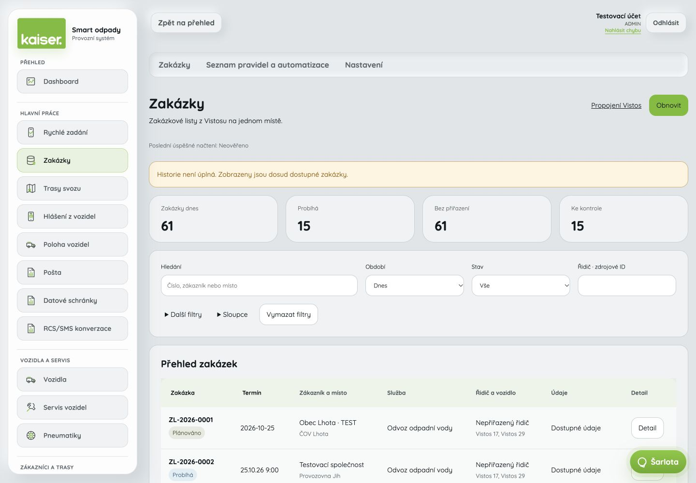
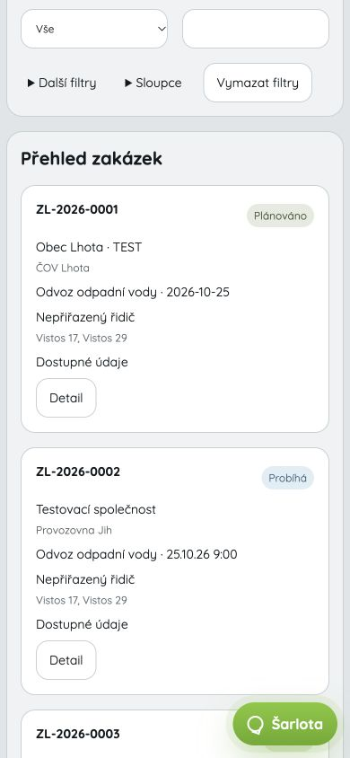
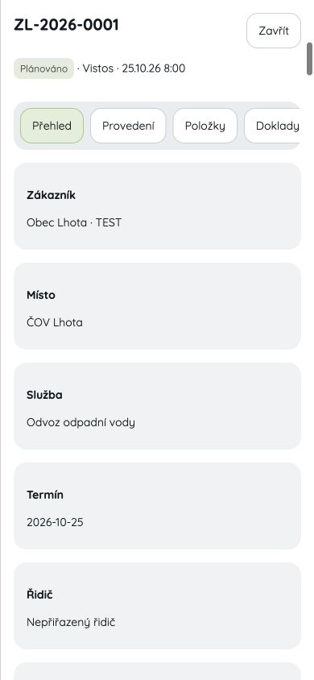
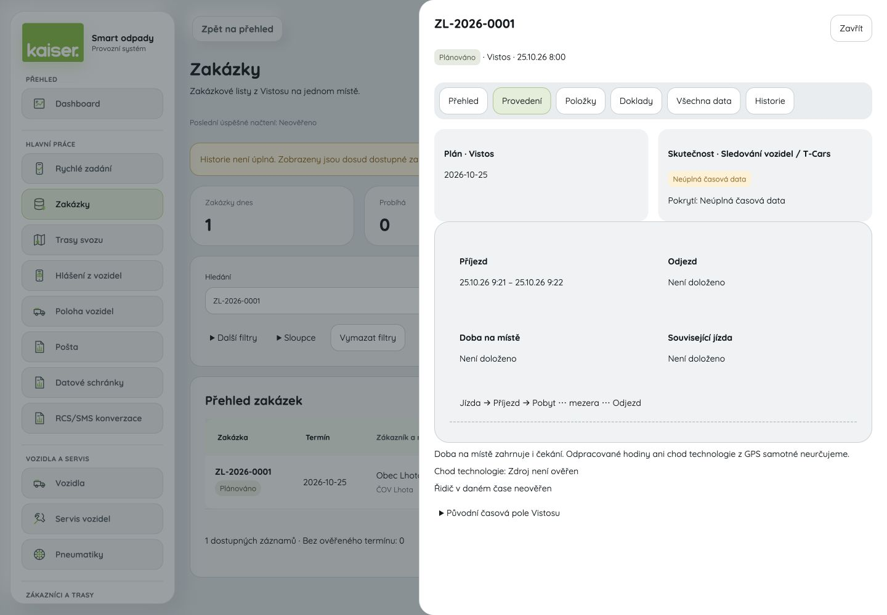
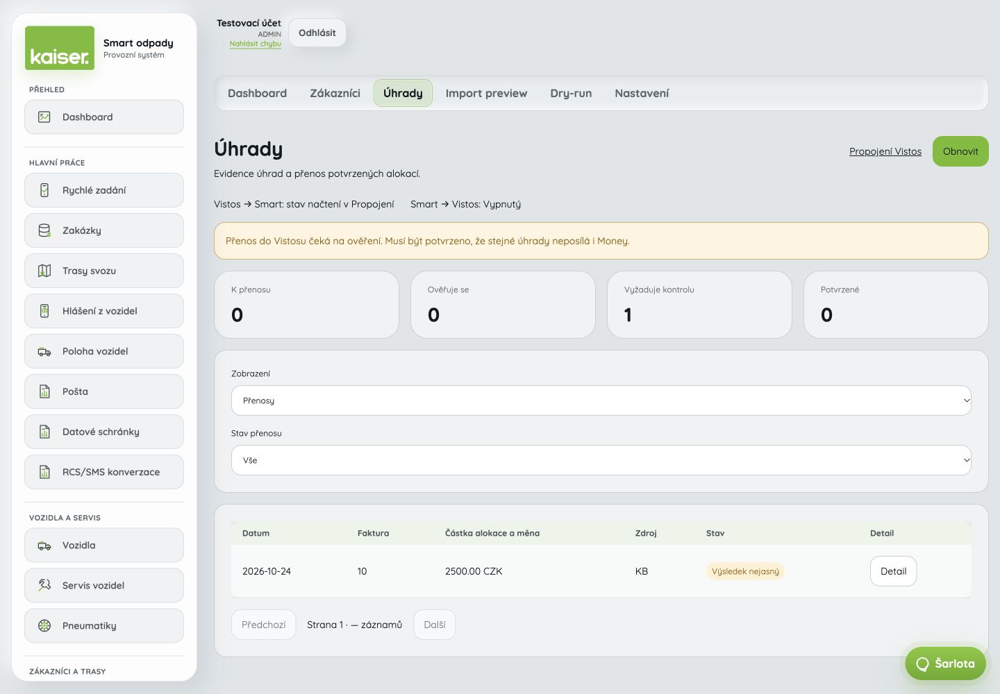
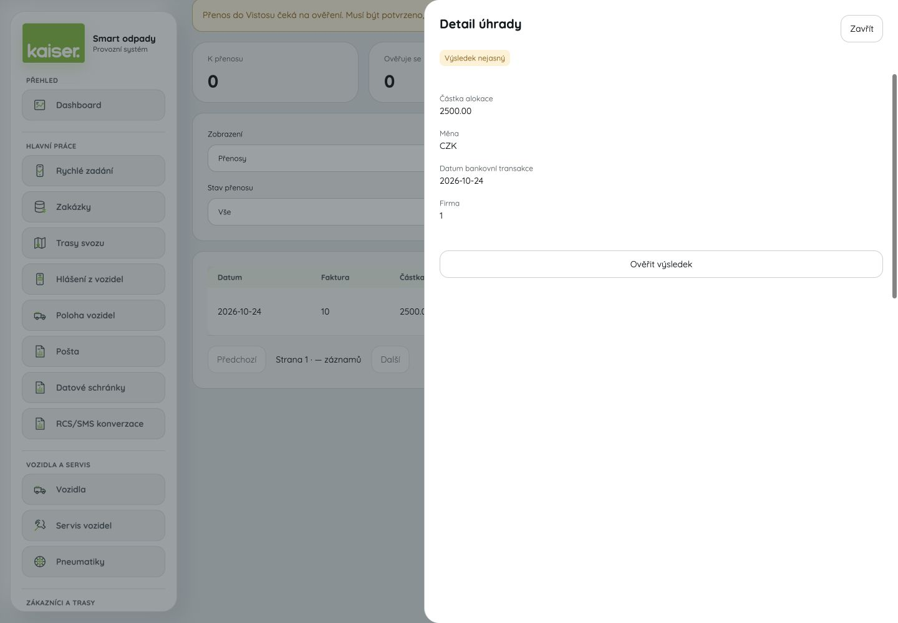

# Izolované ověření 25. 10. 2026

Všechny obrázky obsahují výhradně syntetická data ze `scripts/fixtures/vistos-ui-server.mjs`. Server není produkční fallback a build jej nepublikuje. Lokální browser test proběhl v Chrome na 127.0.0.1, nikoli na produkci. Živé účetní testy nebyly provedeny.

## Automatické kontroly

- `test:vistos-jobs-payments`: 15 testů v reálném SQLite, přesnost desetinných hodnot, ochrana polí a firem, 10 073 záznamů / 101 stran, atomický pád checkpointu a replay, změna počtu, ID/hash rekonciliace bez mazání, samostatná delta, 6 101 GPS bodů přes cursor, neúplné návštěvy a soukromé jízdy, DST, source balance decrease/null/negative, potvrzení a rezervace 2 500 + 5 000, souběžné workery a ztráta lease, lookup po timeoutu Create/Save/Remove, obě faktury při převázání, writer OFF, transport statusy a rotace cookie. Testovaný dataset není 183 073 živých záznamů.
- S01 navíc přes skutečný handler a podepsanou testovací session: finance bez výslovného práva 403, cizí firma 403, strana 3 při pageSize 25 vrací 11 z 61 záznamů, historie vrací uložený audit.
- Existující sady `test:receivables`, `test:vehicle-tracking`, `test:vistos-contacts`, `test:auth-session`, `test:test-mode-contract`, `test:fleet-vistos`, `test:database-architecture` prošly.
- `scripts/self-repair-monitor.test.mjs`: zachovaný zákaz přetečení starého manifestu; nový manifest se pokryje ve dvou omezených bězích, každý maximálně 50 requestů včetně manifestu.
- Všechny migrační soubory CORE, ARCHIVE a AUDIT aplikovány postupně v samostatných čistých SQLite databázích bez chyby. Nejde o Cloudflare migraci.
- Syntax check a build prošly; build obsahuje 52 rout. `git diff --check` bez chyb.

Doménové testy pokrývají rizika skupin J/P/S/T. Názvy skupin nejsou tvrzení, že každý akceptační scénář už prošel živým API, fyzickým telefonem nebo produkčními daty. Zbývající podmínky jsou v provozním předání.

## Prohlížeč

Ověřeno hledání konkrétní zakázky, stránka 2 se záznamy 51–61, přímý odkaz a obnovení detailu, všech šest karet, doslovné zobrazení škodlivého HTML bez vykonání, Escape a návrat focusu na tlačítko zakázky. Neúplné provedení nepřidá odjezd ani dokončenou délku. Nejasná úhrada nabízí ověření výsledku, nikoli nový Create.

Šířky 390, 1024, 1440 a 1920 px bez vodorovného přetékání kořene dokumentu. Při 390 px jsou zakázky v kartách a detail zabírá šířku obrazovky. Jde o emulaci viewportu v desktop Chrome, nikoli fyzický test iPhone.

